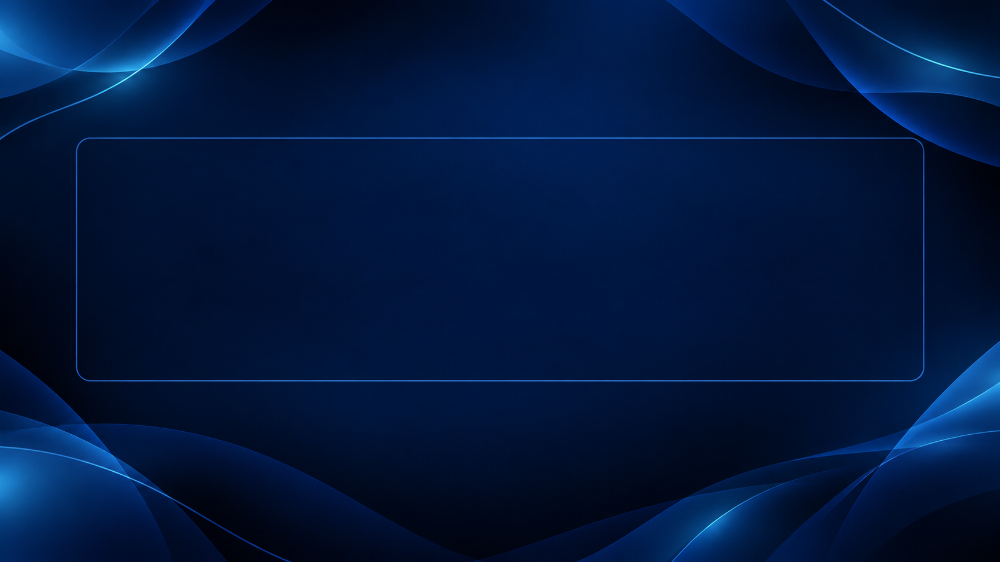

# Gerador de Thumbnails

Aplicação web para gerar thumbnails em lote a partir de uma lista de títulos. Permite editar os textos, ajustar automaticamente a fonte, escolher layouts e exportar imagens PNG diretamente no navegador.

## Layouts

Fundos disponíveis no projeto, antes da aplicação dos títulos:

| Padrão | Escuro | Lateral |
| :---: | :---: | :---: |
|  |  |  |

*Imagens geradas via ChatGPT.*

## Recursos

- Geração de várias thumbnails a partir de títulos separados por linha.
- Edição individual dos títulos na prévia.
- Estimativa de tamanho de fonte com redução automática para caber na área disponível.
- Reajuste da fonte ao redimensionar a janela.
- Layouts Padrão, Escuro e Lateral, com configurações próprias de texto.
- Numeração editável e verificação de números repetidos.
- Download individual ou em lote das thumbnails selecionadas.
- Versão no nome dos arquivos exportados.
- Limite configurável de tamanho de arquivo.

## Como usar

1. Cole os títulos no campo inicial, um por linha, e clique fora do campo para gerar as prévias.
2. Escolha uma opção de layout. Sem uma opção marcada, será usado o layout Padrão.
3. Edite os títulos diretamente nas thumbnails e ajuste a numeração, se necessário.
4. Desmarque as thumbnails que deseja excluir do download em lote.
5. Defina a versão dos arquivos e use **Baixar Thumbnail** ou **Baixar Todas Thumbnails**.

Para manter várias linhas em uma única thumbnail, use os delimitadores em linhas separadas:

```text
[[ Introdução ao tema
Conceitos fundamentais ]]
```

Para extrair um título de uma linha com informações adicionais, use `\\` antes do título e `//` depois:

```text
Informação anterior\\Título da aula//Informação posterior
```

O título extraído será `Título da aula`.

O navegador pode solicitar permissão para baixar vários arquivos.

## Configuração

Os parâmetros de exportação ficam em `CONFIG.download`, no arquivo `src/main.js`:

```js
download: {
    maxFileSizeBytes: 4 * 1024 * 1024,
    width: 1920,
    height: 1920 * (9 / 16),
    format: "image/png"
}
```

- A resolução configurada é **1920 × 1080**, na proporção **16:9**.
- O limite atual é **4 MiB**. Arquivos maiores não são baixados.
- Use `Infinity` em `maxFileSizeBytes` para remover o limite.
- Ao alterar a largura, ajuste a altura para manter a proporção 16:9.

As áreas de texto, cores, fontes e limites de tamanho por layout são configurados em `styles/template-thumbnail.css`.

## Estrutura

```text
index.html                      Página e templates
src/main.js                     Geração, ajuste de fonte e exportação
src/constructNameThumbnail.js   Nomes dos arquivos baixados
styles/                         Estilos da interface e dos layouts
assets/                         Fundos e imagens em base64
lib/html2canvas/                 Biblioteca de exportação e licença
scripts/build.cjs               Geração do HTML de distribuição
dist/index.html                 Arquivo único gerado pela build
```

## Tecnologias e funcionamento

HTML, CSS e JavaScript, com [html2canvas](https://github.com/niklasvh/html2canvas) para renderizar as thumbnails.

As imagens exportadas são geradas no navegador, sem envio dos títulos ou dos PNGs gerados a um servidor. A fonte Archivo é carregada pelo Google Fonts e depende de internet.

### Fontes das thumbnails

Nas thumbnails, **Webdings é usada intencionalmente como fonte alternativa** quando a fonte configurada não está disponível. Ela exibe símbolos no lugar das letras, tornando o problema de fonte evidente. Se o título aparecer com símbolos.

## Licença

Projeto disponibilizado sob a [licença MIT](LICENSE). O html2canvas mantém sua [licença própria](lib/html2canvas/html2canvas-LICENSE.txt), incluída junto da biblioteca.
